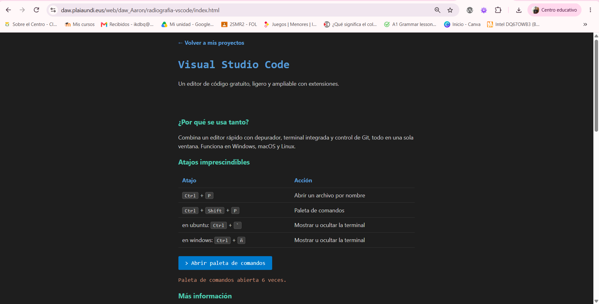

# Radiografía de una herramienta de desarrollo: Visual Studio Code

Página informativa sobre **Visual Studio Code**, un editor de código gratuito, ligero y ampliable con extensiones. Esta versión añade interactividad con JavaScript (DOM y eventos), sin frameworks ni bibliotecas.

## Cómo ejecutarla en local

Los módulos ES (`<script type="module">`) **no funcionan abriendo `index.html` con doble clic** (`file://`): hace falta un servidor local.

Con cualquiera de estas opciones, desde la carpeta del proyecto:

```bash
# Opción 1: Python
python3 -m http.server 8000

# Opción 2: Node
npx serve .
```

Después abre <http://localhost:8000>. También sirve la extensión **Live Server** de VS Code (clic derecho en `index.html` → *Open with Live Server*).

## Estructura

```
index.html          Estructura semántica (header, main, footer)
css/estilos.css     Estilos
js/main.js          Inicializa los eventos
js/datos.js         Array de características (nombre, categoría, descripción)
js/interfaz.js      Funciones que manipulan el DOM
README.md
```

## Funcionalidades

- **Botón «Abrir paleta de comandos»**: al pulsarlo actualiza con `textContent` un mensaje visible en la página. Tiene dos manejadores de `click` (`addEventListener`): uno actualiza el mensaje y otro escribe en la consola.
- **Información ampliada**: un botón muestra y oculta la sección con `classList.toggle`, y mantiene sincronizados su texto y `aria-expanded`.
- **Características generadas con JavaScript**: se crean tarjetas a partir de un array de objetos con `createElement`, `textContent` y `append`. No hay ninguna escrita a mano en el HTML.
- **Búsqueda interactiva**: el campo (con `<label>` asociado) filtra mientras se escribe por nombre o descripción, ignorando mayúsculas y tildes. Si no hay coincidencias, se muestra un mensaje.
- **Accesibilidad**: todos los controles son `<button>` o `<input>`, por lo que se manejan con teclado; el foco es visible.

## Requisitos de la práctica

- Sin `onclick` en el HTML ni `innerHTML` con datos.
- Sin frameworks ni bibliotecas.
- JavaScript organizado en módulos ES.

## Cliente y servidor (evidencia de red)


El servidor local solo entrega archivos estáticos: `index.html`, `css/estilos.css` y los módulos `js/main.js`, `js/datos.js` y `js/interfaz.js`, todos con respuesta 200. El cliente (el navegador) interpreta el HTML, aplica el CSS y ejecuta el JavaScript: crea las tarjetas, filtra la búsqueda y reacciona a los clics sin volver a pedir nada al servidor. `main.js` se pide desde el HTML y este, a su vez, hace que el navegador pida `datos.js` e `interfaz.js` por sus `import`. Lo comprobé en la pestaña Red de las herramientas de desarrollo (F12), recargando la página, y en la consola no aparece ningún error.